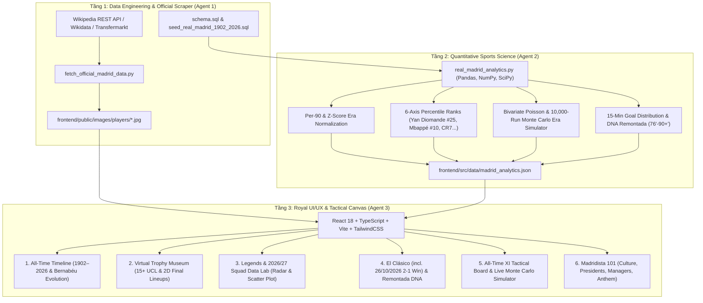

# KIẾN TRÚC HỆ THỐNG — HALAMADRID VN (1902–2026)

## 1. Sơ Đồ Kiến Trúc Tổng Thể (Polyglot Data & Web Architecture)



## 2. Cấu Trúc Thư Mục Chuẩn

```text
D:\halamadrid-vn\
├── .agents\
│   ├── architect.md
│   ├── coder.md
│   ├── reviewer.md
│   └── tester.md
├── data-analysis\
│   ├── models\
│   │   └── schemas.py
│   ├── schema.sql
│   ├── seed_real_madrid_1902_2026.sql
│   ├── fetch_official_madrid_data.py
│   └── real_madrid_analytics.py
├── frontend\
│   ├── public\
│   │   └── images\
│   │       └── players\           # Toàn bộ ảnh chân dung thật của Cầu thủ, Huyền thoại, Chủ tịch, HLV
│   ├── src\
│   │   ├── components\            # 6 Phân hệ tương tác + Navbar + Footer + PlayerModal
│   │   ├── data\
│   │   │   └── madrid_analytics.json
│   │   ├── types\
│   │   │   └── database.ts
│   │   ├── App.tsx
│   │   ├── main.tsx
│   │   └── index.css
│   ├── package.json
│   ├── tsconfig.json
│   ├── vite.config.ts
│   └── vercel.json
├── PLAN.md
├── CONTEXT.md
├── ARCHITECTURE.md
├── API_CONTRACT.md
└── .gitignore
```
